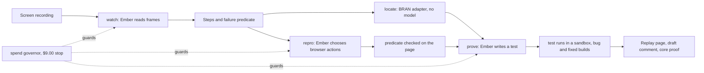

# Foley

Foley turns a screen recording of a user-interface bug into reproduction
steps, file and line anchors in the code, a regression test that fails on the
bug, and a replay page a maintainer can open. It uses Muse Ember,
model `muse-ember-1.0` on the Meta Model API, to watch the recording, drive a
browser and write the test. Every verdict comes from checks Foley runs itself,
not from the model's opinion.

The target application is [Excalidraw](https://github.com/excalidraw/excalidraw)
at a pinned commit. The repository also contains a small seeded-bug app that
runs the whole pipeline offline in a few seconds.

## Why it matters

Many bug reports arrive as a video and nothing else. A maintainer must watch
it, guess the steps, find the code and write a test before work on a fix can
start. Foley does those steps with no person in the loop. It records the cost
of every model call, so the cost per bug is a measured number.

## Pipeline



Text version: the recording goes to watch, which produces ordered steps
and one failure predicate. locate maps the steps to code anchors.
repro drives the local app in Chromium until the predicate is observed.
prove asks for a regression test and runs it in a sandbox. report
writes a draft comment, the replay page and a core-proof record. Every model
call passes through the spend governor in `src/ember.mjs`.

## How Muse Ember is used, and what it is not trusted with

| Stage | What Muse Ember does | What Foley decides without the model |
| --- | --- | --- |
| watch (`src/watch.mjs`) | Reads up to 40 sampled frames (1 per second, at most 1280 px) and returns steps and a typed failure predicate | Recording type, size (50 MB) and duration (120 s) are checked before any request. The reply must pass `validateSteps` |
| locate (`src/locate.mjs`) | Nothing | Anchors come from the BRAN media-evidence adapter, a deterministic search of the pinned target. No model call and no network socket |
| repro (`src/repro.mjs`) | Looks at a screenshot and picks the next browser actions from a fixed set, at most 25 steps per attempt and 3 attempts | Only declared actions run. The browser is locked to one local origin. Success is decided by `src/predicate.mjs` reading the page. The model's own verdict is stored for display only |
| prove (`src/prove.mjs`) | Writes a regression test in the target's own runner, at most 4 rounds with runner output fed back | The test runs inside `tools/isolate.sh` with no network and no credentials. It is accepted only if it fails on the bug build with the predicate's observed and expected values, passes on the fixed build, and repeats that result with no model call |
| report (`src/report.mjs`) | Nothing | Writes a local draft. Foley has no code that posts to GitHub |

Spend is bounded in code. `src/ember.mjs` is the only module that opens a
network connection, and it accepts only `https://api.meta.ai/v1` and model
`muse-ember-1.0`. Before each request it reserves the request's priced upper
bound in a ledger under an exclusive lock and refuses the request if the total
would pass $9.00. The event cap is $10. See [docs/SAFETY.md](docs/SAFETY.md).

## Prior work and event work

- Prior work. `vendor/bran/` is BRAN v0.4.0 (MIT OR Apache-2.0), imported
  unchanged at the tag `baseline-bran-v0.4.0`. BRAN is a deterministic code
  search tool. Its licence and notice files are kept under `vendor/bran/`; see
  [NOTICE](NOTICE).
- Event work. Everything committed after `baseline-bran-v0.4.0` was built
  during the event. That includes `bin/`, `src/`, `ui/`, `tools/`, `test/`,
  `fixtures/` and the new Rust crate
  [`foley-crates/bran-media-evidence`](foley-crates/bran-media-evidence/README.md),
  which calls BRAN as a library.
- To check that BRAN is unchanged, run the command below. It prints nothing
  and exits 0:

  ```sh
  git diff --exit-code baseline-bran-v0.4.0 -- vendor/bran
  ```

## Requirements

- Linux with unprivileged user namespaces. The sandbox in `tools/isolate.sh`
  uses `unshare`.
- Node.js 22.13.0 or later.
- `git`, `ffmpeg`, `ffprobe`, `cargo` (Rust), `unshare` and `flock` on `PATH`.
  Foley refuses to start a run with `tool_absent` when one is missing.
- About 700 MB of disk for the Playwright Chromium builds.
- For a live run only: a Meta Model API key and a local build of Excalidraw
  (`yarn` 1.22 and network access to fetch it).

## Setup

```sh
git clone https://github.com/1wgrumph/foley.git
cd foley
npm ci
npx playwright install chromium
npm run build:ui
```

`npm run build:ui` writes `ui/dist/replay.html`. A run refuses with
`ui_not_built` until it exists.

## Offline demo

```sh
npm run demo:offline
```

The demo needs no key and no network. It starts the seeded-bug app
(`fixtures/app/`, an Archive button that does not archive) and a local fake
model server. It records a short clip of the bug, runs `foley run` on it, then
runs `foley spend`. The expected output ends with:

```text
issue 1: proof_verified (out/runs/1/)
{"baseline":0,"settled":33,"booked":0,"total":33,"per_stage":{"watch":11,"repro":11,"prove":11}}
replay.html: 0 requests besides the page file; 0 console errors
run exit 0; spend exit 0
```

The spend figures are in micro-dollars charged by the fake server, not real
money. The run folder is `out/demo-offline/out/runs/1/`. To see the replay,
open `out/demo-offline/out/runs/1/replay.html` in a browser. The page is one
self-contained file and makes no network request. It shows the recording
beside the replay, the steps, the code anchors, the test, the verdict and the
cost.

## Live run

A live run calls Muse Ember and costs money. It needs:

1. The pinned Excalidraw build. `tools/target-pin.sh --record fixtures/target.json`
   clones Excalidraw into `target/` (ignored by Git), checks out commit
   `eaa7fa32a6645ae9da57eda548e838d0e2a024a1`, builds it and records the
   result. Then serve it on loopback with the `start_command` in
   `fixtures/target.json`.
2. The spend baseline, recorded once in micro-dollars:
   `node bin/foley.mjs baseline <micro-usd>`. Live calls are refused until it
   is set.
3. `MODEL_API_KEY` set in the shell, and `FOLEY_OFFLINE`,
   `FOLEY_EMBER_BASE_URL` and `FOLEY_TEST_API_KEY` unset. The key is read from
   the environment only. It is never written to a file or passed to a child
   process.

Then run one issue and print the spend summary:

```sh
node bin/foley.mjs run <issue> \
  --issue-url https://github.com/excalidraw/excalidraw/issues/<issue> \
  --recording media/cache/<sha256>.mp4 \
  --target target --revision eaa7fa32a6645ae9da57eda548e838d0e2a024a1 \
  --app-origin http://127.0.0.1:<port> --runner vitest \
  --case-budget 400000 --live
node bin/foley.mjs spend
```

`--live` prints `LIVE_URL=<loopback address>`, a read-only page that updates
as the run proceeds.

A real bug-and-fix pair from `fixtures/pairs/pairs.json` runs the same
pipeline against its own builds, after `tools/build-pair.sh <issue>`:

```sh
node bin/foley.mjs run --pair <issue> --recording <file>.mp4 \
  --case-budget 400000
```

The pair supplies the issue URL, the bug and fix commits, the runner and both
built pages. Foley serves the bug build on a loopback port and refuses a
missing build, a commit that differs from the manifest, or a recording whose
SHA-256 differs from the pair's. `foley backlog` runs every eligible issue in
`fixtures/census/census.json`, and `foley eval` scores the held-out set in
`fixtures/eval/held-out.json`. `node bin/foley.mjs help` lists every option.
Exit codes: 0 success or verified proof, 1 finished without a verified proof,
2 refused before any model call, 3 error.

Recordings from public issues are never committed. Fetch each into
`media/cache/` (ignored by Git) and check it against the SHA-256 in the
census; Foley refuses a file whose digest differs.

## Results

No live model call has been made yet. These lines are filled from committed
evidence after the live runs.

- RESULT PENDING: core proof: real Excalidraw issues that passed the whole pipeline (target 3), each with a link to its run folder.
- RESULT PENDING: census counts by status for the 50 issues in `fixtures/census/census.json`.
- RESULT PENDING: held-out evaluation: success per attempt and per eligible issue, top-1 and top-5 location accuracy, every miss listed.
- RESULT PENDING: cost per attempted issue and cost per verified proof, in USD.
- RESULT PENDING: total Muse Ember spend for the event, from `foley spend`, and the link to the published trace.
- RESULT PENDING: link to the demo video.

## Limits

- One target application: Excalidraw at one pinned commit.
- Desktop browser bugs only. Touch and pen issues, security reports and
  recordings with personal or sensitive content are excluded at the census.
- Watch uses sampled frames. The client refuses video and audio parts because
  it cannot price them yet, so narration is not used.
- A real open issue has no fixed build. Prove then has no control run, so the
  result is at best `failure_observed`, not `proof_verified`.
- The sandbox needs Linux user namespaces. Without them, prove does not run
  generated code.
- Taking over a stale run lock has a small race if two commands start at the
  same moment. Run one command at a time per working directory.
- Live updates arrive per model call and per stage, not per browser action.

## Tests

```sh
FOLEY_OFFLINE=1 node --test test/ember/
FOLEY_OFFLINE=1 node --test test/e2e/
node --test test/stages/watch test/stages/report test/stages/backlog test/stages/score test/stages/schema
node --test --test-concurrency=1 test/stages/repro test/stages/predicate test/stages/prove
node --test test/ui/
cargo test --offline --manifest-path foley-crates/bran-media-evidence/Cargo.toml
node tools/check-public.mjs --tree .
```

## More

- [docs/ARCHITECTURE.md](docs/ARCHITECTURE.md): modules, data flow, run
  folder files, trust boundaries.
- [docs/SAFETY.md](docs/SAFETY.md): spend governor, sandbox, browser lock,
  recordings, refusals.
- [docs/SUBMISSION.md](docs/SUBMISSION.md): rubric and event rules mapped to
  evidence.
- [CHANGELOG.md](CHANGELOG.md) and [changelog.d/](changelog.d/): what was
  built, by pull request.

## Licence and credits

Foley's own source is MIT licensed; see [LICENSE](LICENSE). Credits:

- [BRAN](vendor/bran/) v0.4.0, MIT OR Apache-2.0, prior work vendored
  unchanged.
- [Excalidraw](https://github.com/excalidraw/excalidraw), MIT, the analysis
  target. It is not vendored.
- [Playwright](https://playwright.dev/) 1.65.1, Apache-2.0, drives Chromium.
- [axe-core](https://github.com/dequelabs/axe-core) through
  `@axe-core/playwright`, MPL-2.0, for the replay page's accessibility tests.
- [FFmpeg](https://ffmpeg.org/) samples frames and probes recordings. It is a
  system tool and is not distributed with Foley.
