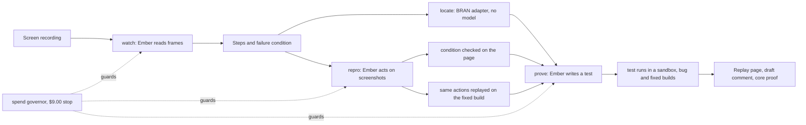

# Foley

Foley takes the screen recording attached to a bug report and returns a
reproduced failure, a regression test that fails on the bug and passes on the
fix, and a replay page, using only Muse Ember (`muse-ember-1.0`) through the
Meta Model API.

## One verified result: Excalidraw issue 9852

Bug: pressing E while drawing a multi-point line switches Excalidraw to the
eraser. Foley ran on the reporter's recording and the issue's bug and fix
commits, with no human edit of its output.

| | Value | Source |
| --- | --- | --- |
| In | The reporter's 23.4 s screen recording | `ffprobe` on `out/demo/9852/recording.mp4` |
| Out | A Vitest test written by Ember. It fails on bug commit `4ce70b8` with `expected 'eraser' to be 'line'` and passes on fix commit `cce5001`. Rerun with no model: bug exit 1, fixed exit 0 | [`docs/evidence/9852-core-proof.json`](docs/evidence/9852-core-proof.json), `out/demo/9852/proof.json` |
| Wall time | 66 s (pipeline 65 s) | [`docs/evidence/9852-repeats.txt`](docs/evidence/9852-repeats.txt) run 18; `out/demo/9852/run.json` `elapsed_ms` 64,618 |
| Cost | $0.005059 for 3 model calls (see note 1) | [`docs/evidence/9852-repeats.txt`](docs/evidence/9852-repeats.txt) run 18 |
| Repeat rate, unchanged code | 5 of 5 runs verified at commit `17791cf`; 3 of 5 at the earlier commit `00e38f7` | [`docs/evidence/9852-repeats.txt`](docs/evidence/9852-repeats.txt) |

Note 1: in this run the Watch call reported 86 prompt tokens. A Watch call on
this recording normally reports about 28,700. This is the unexplained
repeated-request usage figure described under "Measured Ember facts". The five
runs at `17791cf` cost $0.005059 to $0.007482 each.

How Foley uses Muse Ember:

- Watch: Ember reads frames sampled from the recording, 1 per second, and
  returns the steps and a failure condition that Foley can check on the page.
  Ember also accepts the video itself. Video costs about one fifth as many
  tokens, but Watch found 6 of 8 actions from video against 8 of 8 from
  frames, so Foley sends frames.
- Reproduce: Ember sees a 1280 by 720 screenshot each turn and answers with
  key presses and pointer clicks, moves and drags at pixel coordinates.
  Foley's own check of the page decides whether the failure showed.
- Prove: Ember writes the test in the target's own Vitest. Foley runs it in a
  sandbox with no network and no key, on both builds.
- Ember's native computer-use call was measured on the same flow. It
  reproduced the failure for $0.000373 in 9.0 s, against $0.000631 in 4.6 s for
  Foley's screenshot-and-JSON loop. Foley keeps the loop; see
  [Results](#native-computer-use-against-the-loop).

The replay page for this run is `out/demo/9852/replay.html`. It is written by
the run and is not committed, because it embeds the reporter's recording. Its
model-call list and cost cover every run of issue 9852 ($0.257391 in
`out/demo/9852/run.json`), not only this run. The
prompt and token trace of a verified 9852 run is in [`trace/9852/`](trace/9852/).

## Results

Every live figure below comes from runs on 2026-11-25. Amounts are from the
Foley ledger, which records the usage the API reports at the published prices.

### Three real bug-and-fix pairs

Each pair is an Excalidraw issue with a recording, a bug commit and the commit
that fixed it (`fixtures/pairs/pairs.json`).

| Issue | Runs | Result | Spend (S5) | Cause |
| --- | --- | --- | --- | --- |
| 9852 | 19; first verified on run 9 | `proof_verified` | $0.125794 | Verified. Runs 1 to 8 missed while the product was being fixed; see Limits |
| 10840 | 11 | not verified | $0.192960 | The failure needs Alt+R, K, Escape, Alt+R. Ember reached view mode and the laser but never pressed Escape, in 24 attempts over 8 runs. Key presses do not show in the recording |
| 8418 | 5 | not verified | $0.039742 | The reporter asks for a label change. The fix instead turns the button green, adds an icon and disables it, and the label stays. No text condition from the report separates the two builds |

Sources: [`docs/evidence/pairs-runs-summary.json`](docs/evidence/pairs-runs-summary.json)
(run verdicts), `logs/S5-RETURN.md` (spend per pair and causes).

### Repeatability of 9852

| Code | Runs verified | Cost per run | Wall time per run |
| --- | --- | --- | --- |
| Commit `00e38f7` | 3 of 5 | $0.013285 to $0.031716 | 111 to 182 s |
| Commit `17791cf` | 5 of 5 | $0.005059 to $0.007482 | 59 to 76 s |

At `00e38f7` both misses came from Watch choosing a wrong failure condition
and Foley keeping it across Watch rounds. Commit `17791cf` drops a condition
that the bug build contradicts. Source:
[`docs/evidence/9852-repeats.txt`](docs/evidence/9852-repeats.txt).

### Held-out evaluation, 8 issues

The 8 held-out issues (`fixtures/eval/held-out.json`) were chosen in the first
slice and kept apart from the tuning set (`changelog.d/wave-1.md`). They
have no fixed build, so the best result is `failure_observed`.

| Run | Code | `failure_observed` | Proofs | Top-1 and top-5 code location | Cost per issue | Time |
| --- | --- | --- | --- | --- | --- | --- |
| First | `00e38f7`, frozen | 1 of 8 (9812) | 0 | 0 and 0 | $0.017187 | 715 s |
| Second | `17791cf` | 2 of 8 (9812, 9710) | 0 | 0 and 0 | $0.034280 | 1,677 s |

- The first run was made on frozen code. Its output showed one defect that
  stopped 6 of the 7 misses: Ember often writes a sentence before its JSON
  object, and the client refused the whole reply. Commit `969faa0` fixed this
  after the freeze. The client now reads the JSON object that follows the
  text.
- The second run came after that fix and after five fixes found on census
  issues. It is not blind to the reply-format fix. No change was made in
  response to held-out issue content.
- The first run's result stands as the held-out number.

Sources: [`docs/evidence/heldout-run1-report.json`](docs/evidence/heldout-run1-report.json),
[`docs/evidence/heldout-run2-report.json`](docs/evidence/heldout-run2-report.json),
`logs/S6-RETURN.md` and `logs/S6b-RETURN.md`. The second run's cost per issue
is its ledger spend ($0.274241) divided by 8. The report's own figure,
$0.051467, adds the first run's spend.

### Census of 50 Excalidraw bug reports with video

`fixtures/census/census.json` lists 50 issues with a recording, dated
2026-11-24, at Excalidraw commit `eaa7fa3`. Every issue has one status.

| Status | Rerun, commit `17791cf` | First run (S6) |
| --- | --- | --- |
| `failure_observed` | 11 | 5 |
| `attempted_miss` | 25 | 31 |
| `unsupported_device` (touch, pen, mobile, Firefox or macOS only) | 12 | 12 |
| `excluded_sensitive_or_security` | 2 | 2 |
| Total | 50 | 50 |

- `failure_observed` means that Ember's actions brought the pinned build into
  the state that Watch's failure condition names, and Foley's page check read
  the observed value. It does not mean that the bug is confirmed against a
  fix, because census issues have no fixed build. It does not mean that the
  condition is the reporter's bug, because Ember chooses the condition.
- No census issue has a kept failing test. All 11 proofs were rejected: 10
  because Ember's test passed on the bug build or failed on values unrelated
  to the condition, and 1 because the test errored.
- All 25 misses are "failure not shown": reproduction ran, but the page never
  showed the condition's value.
- The 8 held-out issues are among the 36 attempted, with their second-run
  status.

Sources: [`docs/evidence/census-summary.json`](docs/evidence/census-summary.json),
[`docs/evidence/census-rows.json`](docs/evidence/census-rows.json).

### Spend

Total live spend: $2.576656 of the $10 event limit. Foley stops itself at
$9.00. The ledger baseline is 0. Source: `node bin/foley.mjs spend` on this
repository's ledger, copied to
[`docs/evidence/spend-summary.json`](docs/evidence/spend-summary.json).

| Item | Spend |
| --- | --- |
| Protocol probe (video, frames, audio, text, Watch) | $0.013761 |
| Native computer-use pilot | $0.002184 |
| Three pairs, all runs before repeatability | $0.362455 |
| 9852 repeatability, 10 runs | $0.137020 |
| Held-out evaluation, two runs | $0.411735 |
| Census, first run and rerun of 28 issues | $1.649501 |
| Total | $2.576656 |

Item amounts are ledger differences recorded in `logs/S3-RETURN.md`,
`logs/S3b-RETURN.md`, `logs/S5-RETURN.md`, `logs/S6-RETURN.md` and
`logs/S6b-RETURN.md`. They add up to the ledger total.

### Measured Ember facts

The protocol probe ran on the project's own 16.56 s clip,
`fixtures/recordings/owned-basic-flow.mp4`. Sources:
[`fixtures/ember/bounds.json`](fixtures/ember/bounds.json), `out/probe/` and
`logs/S3-RETURN.md`.

- Video against frames: the MP4 as one video part used 4,206 prompt tokens,
  about 251 per second, for $0.000809. 17 frames at 1280 by 720 used 20,520,
  about 1,200 per frame, for $0.00219.
- Output limit: the field is `max_completion_tokens`, and it counts reasoning.
  The default reasoning effort is `max`. At the default, a Watch call spent
  3,998 of 4,000 output tokens on reasoning and returned no content. Foley
  now sets `reasoning_effort`: `medium` for Watch and proof, `low` for
  reproduction.
- Audio: an `input_audio` WAV part returned HTTP 200 for 196 prompt tokens,
  but Ember reported a 10 s 440 Hz tone as silence. Foley refuses audio.
- Repeated identical requests: a request sent a second time with the same
  bytes reported 23 prompt tokens and 0 cached tokens, against 4,619 the first
  time. The same happened in later runs, including the 9852 run above. Foley
  records the figure the API reports. Whether Meta bills by that figure is not
  visible to Foley.
- Prices: on every probe call the ledger cost equals the reported usage at
  $0.10 per million input tokens and $0.50 per million output tokens. The
  cached price is unmeasured.

### Native computer use against the loop

Both drivers ran the same 9852 flow on the bug build and reproduced the
failure on the first attempt.

| Driver | Model calls | Cost | Wall time |
| --- | --- | --- | --- |
| Foley's loop: screenshot in, JSON actions out | 1 | $0.000631 | 4.6 s |
| Native computer use, Responses API | 2 | $0.000373 | 9.0 s |

The first native run stopped on a `pending_safety_checks` confirmation before
any action ($0.000455). Foley keeps the loop, which is faster here and
already has the replay page, tests and turn validation. The governor keeps
the metered computer-use call (`callEmberComputer`). Sources: `out/pilot/`
and `logs/S3b-RETURN.md`.

## Limits and disclosure

- Linux only. The sandbox needs unprivileged user namespaces.
- Chromium only. One issue in the census is reported on Firefox only.
- One target application: Excalidraw.
- `app_notes` and `test_notes` in `fixtures/pairs/pairs.json` are written by a
  person. They describe the target from Excalidraw's help dialog, shortcuts,
  on-screen hints and test helpers, not any issue's answer. One general hint,
  "click to start multiple points, drag for a single line", bears on 9852.
- Eight runs of 9852 came before the first verified run, the ninth. Product
  fixes were made between those runs, using what each run showed.
- The held-out second run is not blind to the reply-format fix.
- The 9852 test has a fallback branch: if the two clicks do not leave a line
  in progress, it sets one through Excalidraw's test API before pressing E.
- Code location is weak. The held-out top-1 and top-5 location scores are 0
  in both runs.
- No comment was posted on any upstream issue. Foley writes drafts
  (`comment.md`) only and has no GitHub write code.
- Census issues have no fixed build, so no census result is a proof.
- The repeated-request usage figure is unexplained, and some costs above are
  low because of it.
- Live updates of the replay page arrive per model call and per stage, not
  per browser action.

## Reproduce

Every command below was run from a fresh clone on 2026-11-25, except the
live pair run, which needs a key. No key value appears here: a live run reads
`MODEL_API_KEY` from the shell environment.

Setup and the offline demo, with no key and no network after setup:

```sh
git clone https://github.com/1wgrumph/foley.git
cd foley
npm ci
npx playwright install chromium
npm run build:ui
npm run demo:offline
```

The demo starts a seeded-bug app (`fixtures/app/`, an Archive button that
does not archive) and a local fake model server, records a clip of the bug and
runs the whole pipeline on it. Its output ends with:

```text
issue 1: proof_verified (out/runs/1/)
{"baseline":0,"settled":33,"booked":0,"total":33,"per_stage":{"watch":11,"repro":11,"prove":11}}
replay.html: 0 requests besides the page file; 0 console errors
run exit 0; spend exit 0
```

The amounts are fake-server micro-dollars. Open
`out/demo-offline/out/runs/1/replay.html` in a browser to see the replay page.
To read the demo's spend again:

```sh
(cd out/demo-offline && node ../../bin/foley.mjs spend)
```

A pair run of 9852. `tools/build-pair.sh` needs network access to clone and
build both Excalidraw commits; it took 87 s here. Then fetch the reporter's
recording into the Git-ignored `media/cache/`, check its SHA-256, record the
spend baseline once in micro-dollars (0 when nothing was spent before) and
dry-run the pair:

```sh
tools/build-pair.sh 9852
mkdir -p media/cache
curl -fsSL https://github.com/user-attachments/assets/c0901eb0-3b82-46a8-a883-64778e3b18e0 \
  -o media/cache/de0b3bde075388266bcf5bc9818d194f37e928e925b12be65557ddf58da9279c.mp4
echo "de0b3bde075388266bcf5bc9818d194f37e928e925b12be65557ddf58da9279c  media/cache/de0b3bde075388266bcf5bc9818d194f37e928e925b12be65557ddf58da9279c.mp4" | sha256sum -c -
node bin/foley.mjs baseline 0
node bin/foley.mjs run --pair 9852 \
  --recording media/cache/de0b3bde075388266bcf5bc9818d194f37e928e925b12be65557ddf58da9279c.mp4 \
  --case-budget 400000 --dry-run
```

The dry run prints `dry run: issue 9852 ready; no model call made` and makes
no model call. A run refuses with `baseline_unset` until the baseline is
recorded. The live run is the same command without `--dry-run`. It needs
`MODEL_API_KEY` in the environment and `FOLEY_OFFLINE` unset; it was not run
in this check. Read the spend with:

```sh
node bin/foley.mjs spend
```

In the fresh clone it printed a zero total. On the project's own ledger, after
every live run, it printed:

```text
{"baseline":0,"settled":2576656,"booked":0,"total":2576656,"per_stage":{"probe":5606,"watch":954813,"repro":1336714,"prove":265225}}
```

`node bin/foley.mjs help` lists every command, including `backlog` for the
census and `eval` for the held-out set. Exit codes: 0 success or verified
proof, 1 finished without a verified proof, 2 refused before any model call,
3 error.

## Pipeline



Text version: watch turns the recording into ordered steps and one failure
condition. locate maps the steps to code lines. repro drives the local app in
Chromium until Foley's page check sees the failure, and for a pair replays
the same actions on the fixed build, where the failure must not show. prove
asks for a regression test and runs it in a sandbox on both builds. report
writes a draft comment, the replay page and a core-proof record. Every model
call passes through the spend governor in `src/ember.mjs`.

## What Ember does and what Foley decides

| Stage | What Muse Ember does | What Foley decides without the model |
| --- | --- | --- |
| watch (`src/watch.mjs`) | Reads up to 40 sampled frames and returns steps and a typed failure condition. One re-ask if the reply breaks the steps schema; up to 2 more Watch rounds if reproduction does not show the failure | Recording type, size (50 MB) and duration (120 s) are checked before any request. The reply must pass `validateSteps` |
| locate (`src/locate.mjs`) | Nothing | Code lines come from the BRAN media-evidence adapter, a deterministic search of the target. No model call and no network socket |
| repro (`src/repro.mjs`) | Looks at a screenshot and picks the next actions, including pointer actions at pixel coordinates. At most 25 steps per attempt and 3 attempts | Only declared actions run, and a turn with any invalid action runs none. The browser is locked to one local origin. `src/predicate.mjs` decides from the page. The model's own verdict is kept for display only |
| prove (`src/prove.mjs`) | Writes a test in the target's own runner, at most 4 rounds with runner output fed back | The test runs inside `tools/isolate.sh`. It is accepted only if it fails on the bug build with the condition's observed and expected values, passes on the fixed build, and repeats both results with no model call |
| report (`src/report.mjs`) | Nothing | Writes a local draft. Foley has no code that posts to GitHub |

`src/ember.mjs` is the only module that opens a network connection. It accepts
only `https://api.meta.ai/v1` and model `muse-ember-1.0`. Before each request
it reserves the request's priced upper bound under a lock and refuses the
request if the total would pass $9.00. See [docs/SAFETY.md](docs/SAFETY.md).

## Prior work and event work

- Prior work. `vendor/bran/` is BRAN v0.4.0 (MIT OR Apache-2.0), imported
  unchanged at the tag `baseline-bran-v0.4.0`. BRAN is a deterministic code
  search tool. Its licence and notice files are kept under `vendor/bran/`; see
  [NOTICE](NOTICE).
- Event work. Everything committed after `baseline-bran-v0.4.0` was built
  during the event. That includes `bin/`, `src/`, `ui/`, `tools/`, `test/`,
  `fixtures/` and the new Rust crate
  [`foley-crates/bran-media-evidence`](foley-crates/bran-media-evidence/README.md),
  which calls BRAN as a library.
- To check that BRAN is unchanged, run the command below. It prints nothing
  and exits 0:

  ```sh
  git diff --exit-code baseline-bran-v0.4.0 -- vendor/bran
  ```

## Requirements

- Linux with unprivileged user namespaces. The sandbox in `tools/isolate.sh`
  uses `unshare`.
- Node.js 22.13.0 or later.
- `git`, `ffmpeg`, `ffprobe`, `cargo` (Rust), `unshare` and `flock` on `PATH`.
  Foley refuses to start a run with `tool_absent` when one is missing.
- About 700 MB of disk for the Playwright Chromium builds.
- For a live run only: a Meta Model API key, and `yarn` 1.22 with network
  access to build Excalidraw.

## Tests

```sh
FOLEY_OFFLINE=1 node --test test/ember/
FOLEY_OFFLINE=1 node --test test/e2e/
node --test test/stages/watch test/stages/report test/stages/backlog test/stages/score test/stages/schema
node --test --test-concurrency=1 test/stages/repro test/stages/predicate test/stages/prove
node --test test/ui/
cargo test --offline --manifest-path foley-crates/bran-media-evidence/Cargo.toml
node tools/check-public.mjs --tree .
```

## More

- [docs/SUBMISSION.md](docs/SUBMISSION.md): submission text, demo script,
  rubric and event rules mapped to evidence.
- [docs/ARCHITECTURE.md](docs/ARCHITECTURE.md): modules, data flow, run
  folder files, trust boundaries.
- [docs/SAFETY.md](docs/SAFETY.md): spend governor, sandbox, browser lock,
  recordings, refusals.
- [docs/evidence/](docs/evidence/README.md): the result files cited above.
- [CHANGELOG.md](CHANGELOG.md) and [changelog.d/](changelog.d/): what was
  built, by pull request.

## Licence and credits

Foley's own source is MIT licensed; see [LICENSE](LICENSE). Credits:

- [BRAN](vendor/bran/) v0.4.0, MIT OR Apache-2.0, prior work vendored
  unchanged.
- [Excalidraw](https://github.com/excalidraw/excalidraw), MIT, the analysis
  target. It is not vendored.
- [Playwright](https://playwright.dev/) 1.65.1, Apache-2.0, drives Chromium.
- [axe-core](https://github.com/dequelabs/axe-core) through
  `@axe-core/playwright`, MPL-2.0, for the replay page's accessibility tests.
- [FFmpeg](https://ffmpeg.org/) samples frames and probes recordings. It is a
  system tool and is not distributed with Foley.
