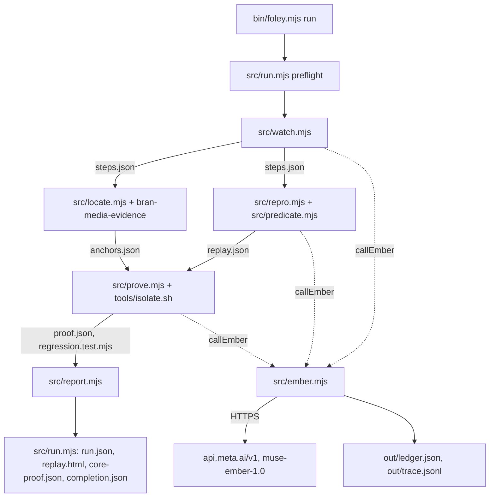

# Foley architecture

This document describes the modules, the data flow, the files of a run folder,
the trust boundaries and the closed result sets. Each item names the file that
implements it. Paths are relative to the repository root.

## Modules

| File | Role |
| --- | --- |
| `bin/foley.mjs` | Command line: `run`, `backlog`, `eval`, `spend`, `baseline`, `--version`, `help`. Maps outcomes to exit codes 0 to 3 |
| `src/run.mjs` | Preflight checks, the run lock, the stage journal, the run document, the static replay page and the core-proof record. Shared by `run` and `backlog` |
| `src/ember.mjs` | The only module that opens a network connection. Muse Ember client, spend governor, ledger and trace |
| `src/watch.mjs` | Recording to steps and a failure predicate. Checks the media, samples frames with `ffmpeg` |
| `src/locate.mjs` | Steps to file and line anchors. Builds and runs the `bran-media-evidence` binary and checks each anchor against the pinned revision |
| `foley-crates/bran-media-evidence/` | Rust crate built during the event. Derives search terms from the steps and calls the vendored BRAN library for the scan and graph query |
| `src/repro.mjs` | Observe-act browser loop through Playwright, with the origin lock and the declared action set |
| `src/predicate.mjs` | Checks a typed predicate against the live page: `visible_text`, `element_count`, `console_error`, `canvas_state` |
| `src/prove.mjs` | Regression-test loop. Runs each candidate through `tools/isolate.sh` on the bug build and the fixed build |
| `tools/isolate.sh` | Sandbox for model-written tests |
| `src/report.mjs` | Draft issue comment, `comment.md` |
| `src/backlog.mjs` | Runs a dated census one issue at a time and resumes after interruption |
| `src/eval.mjs`, `src/score.mjs` | Held-out evaluation and its scores |
| `src/run-schema.mjs` | Schemas for steps and run documents, the spend summary and the core-proof check |
| `src/text-safety.mjs` | One credential-shape check used at the input and display boundaries |
| `src/live.mjs` | Read-only loopback server for `foley run --live` |
| `ui/` | Replay page source. `ui/build.mjs` writes `ui/dist/replay.html`; `ui/render.mjs` fills it per run |
| `tools/check-public.mjs` | Public-boundary check run before every push |
| `vendor/bran/` | BRAN v0.4.0, prior work, unchanged |

## Data flow

Text version:

1. `bin/foley.mjs run` calls the preflight in `src/run.mjs`. It checks the
   tools on `PATH`, the built replay page, the pinned target revision, the
   recording and that every path stays inside the working directory. A failed
   check is a refusal with exit code 2 and no model call.
2. The pipeline takes the kernel lock `out/foley-run.lock` and runs the stages
   watch, locate, repro, prove and report through the journal
   `out/runs/<issue>/state.json`. Each stage has at most two attempts. A
   finished stage is never repeated.
3. watch, repro and prove call Muse Ember only through the `callEmber`
   function of `src/ember.mjs`. locate and report make no model call.
4. After report, `src/run.mjs` writes the final run document, the static
   replay page, the artifact trace and the core-proof record. It writes
   `completion.json` last, and only after `checkCoreProof` passes.

## The run folder

A run writes to `out/runs/<issue>/`. `out/` is ignored by Git. The offline
demo writes the same files to `out/demo-offline/out/runs/1/`.

| File | Written by | Holds |
| --- | --- | --- |
| `recording.mp4` (or `.mov`, `.webm`) | `src/run.mjs` | Copy of the input recording |
| `watch.trace.jsonl` | `src/watch.mjs` | Media path used (`frames` or `video`) |
| `steps.json` | `src/watch.mjs` | `foley.steps/1`: ordered steps and the predicate |
| `anchors.json` | `src/locate.mjs` | `foley.anchors/1`: ranked file and line anchors, or a miss |
| `replay.json` | `src/repro.mjs` | Attempts, executed, blocked and dropped actions, predicate result |
| `screenshots/` | `src/repro.mjs` | Browser frames |
| `proof.json` | `src/prove.mjs` | Test rounds, bug and fixed build results, rerun without the model |
| `regression.test.mjs` | `src/prove.mjs` | The accepted test |
| `comment.md` | `src/report.mjs` | Draft comment: steps, anchors, test, verdict, cost |
| `run.json` | `src/run.mjs` | `foley.run/1`: the whole run, including every model call with stage, tokens and cost |
| `replay.html` | `src/run.mjs`, `ui/render.mjs` | Self-contained replay page |
| `artifact-trace.jsonl` | `src/run.mjs` | SHA-256 of each artifact |
| `core-proof.json` | `src/run.mjs` | `foley.core-proof/1`: stage results, rerun result, artifact digests |
| `completion.json` | `src/run.mjs` | Written last; marks the run complete |
| `state.json` | `src/run.mjs` | Stage journal used for resume |
| `census.json` | `src/backlog.mjs` | Backlog runs only: `{issue, status}` for each candidate |

Shared files under `out/`:

| File | Written by | Holds |
| --- | --- | --- |
| `ledger.json` | `src/ember.mjs` | Cap, baseline, settled spend and open reservations, in integer micro-dollars |
| `trace.jsonl` | `src/ember.mjs` | One event per baseline, request, refusal and recovery |
| `prompts/` | `src/ember.mjs` | Prompt text by digest. Never published |
| `stage-spend.jsonl` | `src/run.mjs` | Call ID to stage |
| `spend-summary.json` | `src/run-schema.mjs` via `foley spend` | Baseline, settled, booked, total and spend per stage |
| `backlog-report.json` | `src/backlog.mjs` | One row per census issue |
| `eval-report.json` | `src/eval.mjs` | Held-out scores |

## Trust boundaries

Recordings, model output and model-written test code are untrusted.

| Boundary | Rule | File |
| --- | --- | --- |
| API key | Read from `MODEL_API_KEY` by `src/ember.mjs` only. Not logged, traced or passed to a child process | `src/ember.mjs`, `src/locate.mjs` (`childEnv`) |
| Network | Only `src/ember.mjs` opens a connection, to one fixed host and model. Test mode accepts only literal loopback addresses | `src/ember.mjs` |
| Recording | Type, size, duration and content checked before any copy or request | `src/watch.mjs`, `src/run.mjs` |
| Model reply | Must be a JSON object that passes its schema. A whole repro turn is checked before any action runs | `src/run-schema.mjs`, `src/repro.mjs` |
| Browser | One exact local origin; other origins, file URLs and downloads blocked and recorded | `src/repro.mjs` |
| Model-written test | Runs only in the sandbox, with no network and an empty environment | `tools/isolate.sh`, `src/prove.mjs` |
| Command-line paths | Must stay inside the working directory | `src/run.mjs` (`insideCwd`) |
| Replay page | Reads only its run folder. Run data is rendered as text. The live server is loopback and read-only | `ui/render.mjs`, `src/live.mjs` |
| Publication | No keys, home paths, raw prompts, `out/` files or media without provenance | `tools/check-public.mjs` |
| Upstream | No code path writes to GitHub | `src/report.mjs` |

## Closed result sets

Every outcome is one value from a fixed list. Stages switch on these values,
and an unknown value is refused.

| Set | Values | File |
| --- | --- | --- |
| Muse Ember call result | `ok`, `budget_refused`, `ledger_unreadable`, `api_error`, `rate_limited`, `timeout`, `malformed_output`, `refused_input` | `src/ember.mjs` |
| Issue status | `no_usable_media`, `unsupported_device`, `excluded_sensitive_or_security`, `eligible_not_attempted`, `attempted_miss`, `failure_observed`, `proof_verified` | `src/backlog.mjs` |
| Predicate kind | `visible_text`, `element_count`, `console_error`, `canvas_state` | `src/predicate.mjs` |
| Run state | `empty`, `running`, `error`, `disconnected`, `finished` | `src/run-schema.mjs` |
| Browser action | `click`, `double_click`, `drag`, `move`, `scroll`, `type`, `key_press`, `wait`, `screenshot` | `src/repro.mjs` |
| Exit code | 0 success or verified proof, 1 no verified proof or backlog interrupted, 2 refused before any model call, 3 error | `bin/foley.mjs` |
